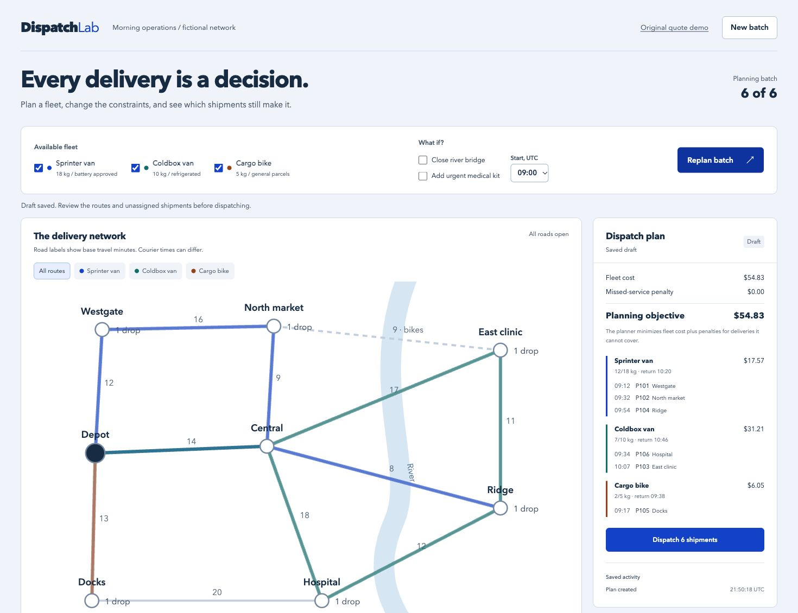
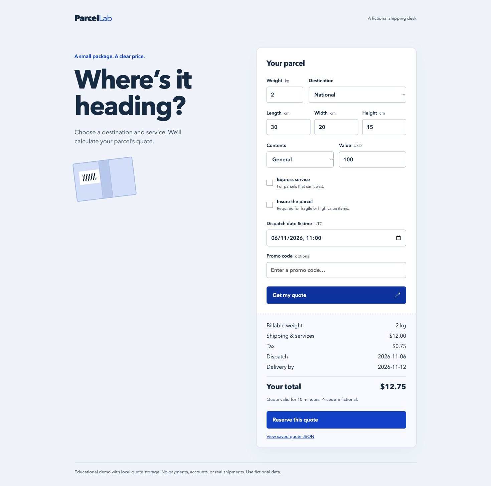

# REA hardening lab

A full-stack Next.js application for testing a specific question: **can a model-assisted analyst recover exact behavior from a compiled app after `die-a-rea` hardening, and how much effort does it take?**

## Current app: Dispatch Lab (V2)

The home page is now a working dispatch planner: **eight locations, twelve roads, three different couriers, six shipments and an optional urgent delivery**. It computes routes and fleet assignments together, respecting capacity, delivery windows, service time, refrigeration, battery certification, bike-only roads and the return journey. Drafts and dispatches persist in SQLite; transactional reservations prevent competing plans from double-booking a shipment or courier.



| Try this | Verified result |
| --- | --- |
| Full fleet, 09:00 | Six of six delivered; $54.83 objective |
| Close the river bridge | Different route; six delivered; $62.03 |
| Remove the refrigerated van | Both medical shipments unassigned |
| Add the urgent medical kit | Six of seven delivered; P106 displaced; $149.37 including missed-service penalty |
| Commit two competing drafts | One succeeds; the conflicting commit returns 409 |

Run the commands below, then open `/` for Dispatch Lab or `/quote` for the original app. Check the running V2 API with:

```sh
npm run test:dispatch -- http://127.0.0.1:4320 evidence/v2/functional-checks.json
```

[Planner design and boundaries](docs/dispatch-planner.md) · [V2 checks and screenshots](evidence/v2/README.md) · [Review of the original experiment](docs/test-audit.md)

**V2 has functional test evidence, but no REA/die-a-rea recovery result yet.** The historical measurements below apply only to V1. The original lab scripts still target the quote calculation; they are not a V2 benchmark harness.

## Historical experiment: Parcel Lab (V1)

**Observed result, 6 November 2026:** both independent recovery implementations matched **42/42 frozen reference cases**. The hardened build also passed the original app's API checks. This customized configuration obscured the code and enlarged the artifacts; it did not prevent recovery of the copied server calculation. **That does not establish whether die-a-rea increased recovery effort:** the run did not reliably measure tokens, cost or repeated timings, and used reduced noise with prompt gates disabled.

This is one small experiment, not a general benchmark or a promise about every REA workflow. [Method and evidence](evidence/README.md) · [Machine-readable results](evidence/summary.json) · [Recovered implementations](recoveries)



## What the app does

Parcel Lab is a fictional shipping desk with a React form, Next.js route handlers, and a local SQLite database. Its rules interact:

- Actual versus dimensional weight, rounded to half-kilogram billing bands.
- Negotiated route floors and marginal weight rates.
- Express, fragile-item and battery restrictions; insurance requirements.
- Fuel, handling, insurance, remote-route fees and tax rounding.
- Promo eligibility, caps and exclusions.
- UTC dispatch cutoffs, weekends, holiday exceptions and remote pickup days.
- Ten-minute stored quotes, retrieval and idempotent reservation.

The client runs a preflight eligibility check. The server independently validates requests and calculates the authoritative quote. Pricing tables, promo eligibility and calendar exceptions are server code. Synthetic constants make exact reconstruction testable; ordinary shipping intuition cannot supply them.

No payments, real carrier integration, accounts, or production authentication are included. Quote IDs are locators, not an authorization mechanism. Keep this educational demo on loopback and use fictional input. SQLite needs writable local storage; this is not a serverless deployment recipe.

## Run the application

Use Node **24.22.2** (`.nvmrc`). REA 6.8.0 has stricter Node patch requirements than Next.js; an earlier Node 24 release is insufficient for REA.

```sh
git clone https://github.com/Frostdev7506/rea-hardening-lab.git
cd rea-hardening-lab
nvm install
nvm use
npm ci
npm test
npm run build
npm run typecheck
npm run lint
PORT=4320 HOSTNAME=127.0.0.1 npm start
```

Open [http://127.0.0.1:4320](http://127.0.0.1:4320) for V2. The original quote app is at [http://127.0.0.1:4320/quote](http://127.0.0.1:4320/quote). In another terminal:

```sh
npm run test:api -- http://127.0.0.1:4320 evidence/api-before.json
```

The default national parcel costs **$12.75**, dispatches **2026-11-06** and arrives by **2026-11-12** under the fictional reference calendar. The form deliberately defaults to a fixed date so the example stays reproducible. Money is integer cents; date rules use UTC.

`npm run dev` starts the editable development version. Experiments must use the production build, where Next.js has already minified the client code and browser source maps are disabled.

## Reproduce the REA and die-a-rea runs

For the exact V1 application build, use a separate checkout at commit `a1d40a2bae3f015a32a3925d62723d3802477024`. To inspect the original supplied chunks in this current checkout, run `npm run evidence:unpack`; it verifies the four compressed snapshots against the recorded SHA-256 values. See the [audit](docs/test-audit.md) for the original scorer and publication defects corrected here.

Prerequisites: Git, a supported Node version, and Rust stable with Cargo. The recorded run used macOS arm64, Node 24.22.2 and Rust 1.99.1. `npm ci` installs REA **6.8.0** and `javascript-obfuscator` **5.10.0** locally. No agent-wide REA setup or paid API key is needed for these static CLI scans.

Build the exact hardening-tool revision:

```sh
mkdir -p .tools
git clone https://github.com/danihelenterprises/die-a-rea.git .tools/die-a-rea
git -C .tools/die-a-rea checkout --detach 0d322552673309372f9937bc5f0c50641ed1514e
cargo build --release --locked \
  --manifest-path .tools/die-a-rea/Cargo.toml -p direa-cli
```

After `npm run build`, capture the two production chunks, scan them, then harden and rescan:

```sh
npm run lab -- collect
npm run lab -- analyze before
npm run lab -- harden
npm run lab -- analyze after
npm run lab -- runtime
```

`collect` selects the browser page chunk containing the quote request and the compiled `/api/quote` server route. These are deliberately separate access models: a visitor can download the browser chunk; possession of the server route assumes a copied/leaked build. REA is given scoped chunk snapshots, not the source repository or a complete Next.js deployment.

The `lab` script runs commands directly without a shell, captures complete REA output, and records sizes, hashes and elapsed times. REA evidence is stored as JSON plus a compressed copy. The JavaScript adapter receives `NODE_PATH` pointing at this repository's installed dependencies. For a tool checkout elsewhere, set `DIREA_REPO=/absolute/path/to/die-a-rea` for the hardening command.

The committed [manifest](die-a-rea.toml) uses the `high` policy with 40 decoy functions, 80 decoy strings and 8 KiB of padding. Prompt gates are disabled. `--seed` fixes the built-in decoy layout; it does not guarantee deterministic output from the external obfuscator. Check `evidence/die-build.json`: an apparently successful host run is insufficient if the adapter reports skipped or failed obfuscations.

The script uses explicit nested artifact and build-metadata paths for verification. Both matter at this pinned tool revision. To inspect the browser score manually, run from `artifacts/`:

```sh
../.tools/die-a-rea/target/release/die-a-rea verify \
  --original before/browser/app.js \
  --hardened hardened/before/browser/app.js \
  --build-meta hardened/die-a-rea.build.json --json
```

## Check the actual hardened app

`lab runtime` creates a separate standalone copy and replaces only the two analyzed chunks. It preserves their Next.js filenames and leaves the original build intact. This is a tested integration for this demo, not a universal Next.js hardening plugin; other apps may use integrity checks, caching or compilation features that need separate handling. It refuses an existing hardened runtime directory.

In another terminal:

```sh
PORT=4321 HOSTNAME=127.0.0.1 node artifacts/runtime-hardened/server.js
```

Then:

```sh
npm run test:api -- http://127.0.0.1:4321 evidence/api-after.json
node scripts/score-recovery.mjs before recoveries/before/recovered.mjs
node scripts/score-recovery.mjs after recoveries/after/recovered.mjs
node scripts/summarize.mjs
```

Scoring checks complete quote objects for 35 eligible scenarios and rejection for seven ineligible scenarios. Booking retries, saved-quote reads and malformed/oversized requests are tested separately against both actual servers. These published cases are no longer hidden from future attempts; create fresh held-out cases for a new recovery experiment.

## Recorded results

| Measurement | Original production chunk | Hardened chunk |
| --- | ---: | ---: |
| Browser JavaScript | 7,896 bytes | 55,677 bytes |
| Browser JavaScript, gzip | 2,824 bytes | 20,714 bytes |
| Server route JavaScript | 14,435 bytes | 72,490 bytes |
| Server route JavaScript, gzip | 6,089 bytes | 27,819 bytes |
| API reference cases | 42/42 | 42/42 |
| Recovered calculation, held-out cases | 42/42 | 42/42 |

Only these chunks are measured. **7.33× browser gzip growth** is not a measurement of the entire site's transfer size or load time. The tool's RRS was **45/100** for the browser chunk and **34/100** for the server chunk. Those are exposure/noise proxy scores, not percentages of recovery prevented.

Both fresh recovery agents had the same eight-minute limit and received only compiled snapshots, REA reports and a public input schema. The original calculation was read from minified code. The hardened calculation was recovered by decoding the string table, tracing helper expressions, and ignoring decoys. Neither attempt queried the API or read the original source/tests. Source restrictions were instructional rather than enforced by an OS sandbox; reports disclose their exact access and the baseline attempt's methodology-skill read. Source publication happened after both attempts finished.

An additional integration cost appeared during publication: GitHub push protection rejected the decoded diagnostic file because it contained token-shaped decoys. The pinned tool deliberately [generates synthetic credential-shaped strings](https://github.com/danihelenterprises/die-a-rea/blob/0d322552673309372f9937bc5f0c50641ed1514e/crates/direa-core/src/random.rs). We kept that reproducible diagnostic local and ignored, retaining the original hardened artifacts, decoder and verification scripts. Push protection was not disabled or bypassed with an exemption.

REA's static scans parsed all four chunks without parse failures. The separate agents completed the semantic recovery; this does **not** show that the REA CLI alone generated working replacements. Single-run timings, recovery success in this one app, and a small finite test set cannot establish a general resistance rate.

The browser build contained none of the three checked server markers: the two promo codes and a holiday exception. That supports the narrower statement that these literals were not shipped in the scanned public assets. It does not prove API behavior cannot reveal or approximate server rules.

## Sources

- [Official REA](https://github.com/morluto/rea) and its [installation/readiness guide](https://github.com/morluto/rea/blob/main/docs/installation.md).
- [Pinned die-a-rea](https://github.com/danihelenterprises/die-a-rea/tree/0d322552673309372f9937bc5f0c50641ed1514e), [RRS model](https://github.com/danihelenterprises/die-a-rea/blob/0d322552673309372f9937bc5f0c50641ed1514e/docs/RRS.md), and [threat model](https://github.com/danihelenterprises/die-a-rea/blob/0d322552673309372f9937bc5f0c50641ed1514e/docs/THREAT-MODEL.md).

Application and lab code: MIT. Dependency licenses remain with their respective owners.
